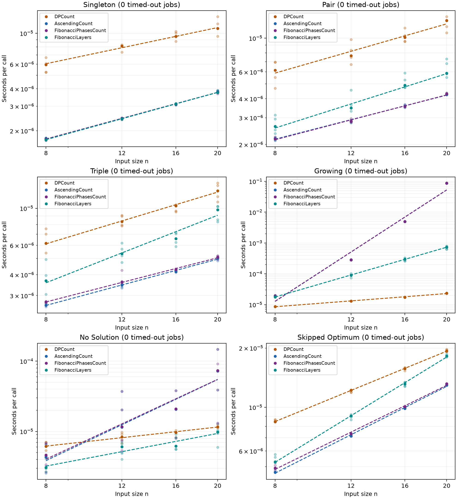
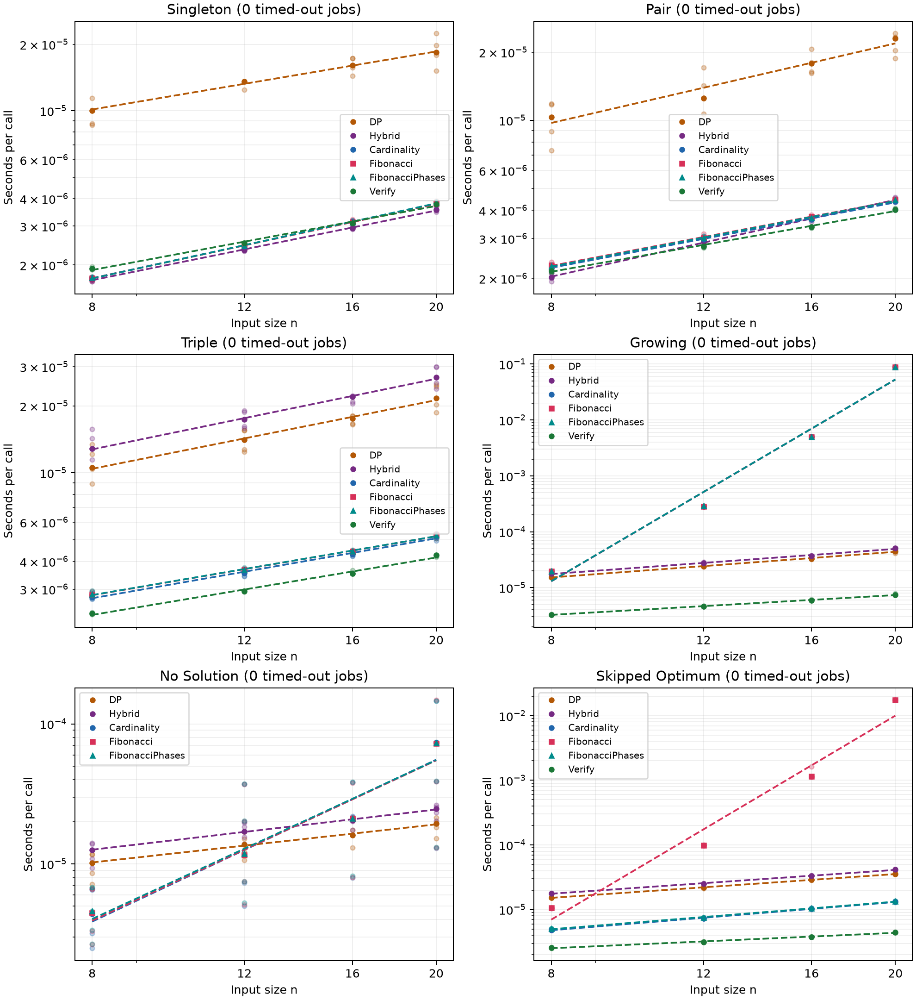
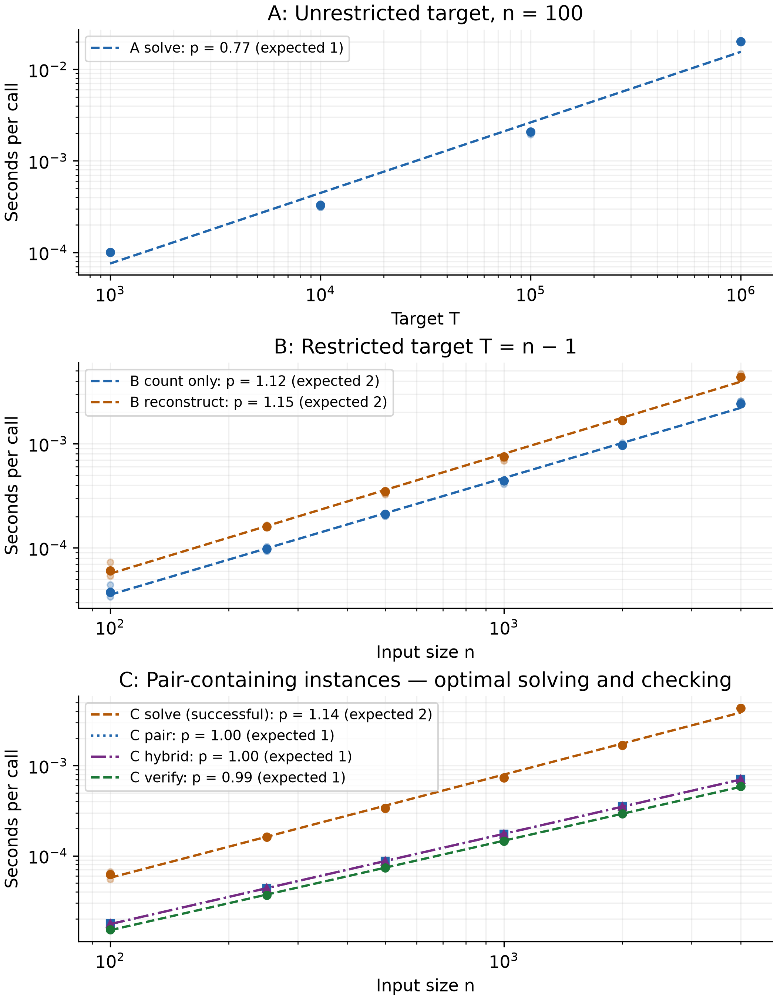

# Minimum-cardinality Subset Sum: Experiments and Implementation

This companion to [the research note](../../papers/np-complete.md) compares dynamic programming (DP), early singleton/pair searches, ascending and Fibonacci-first cardinality search, incremental partial-sum layers, and certificate checking. The studies below use different subset rules and target families. Their results are reported separately.

## Verification: Search Cardinality Layers from Both Ends

**Bidirectional layers can establish the minimum correctly, but their benefit depends on the input.** The [forward-only and alternating count-only prototypes](bidirectional_prototypes.py) are published with their [per-input results](bidirectional/results.json), exhaustive checks, and seeded-input replay. This is an operation-count investigation, not a new timed benchmark or a change to the public solver. The measured performance section below still describes the existing forward-only implementation.

For a positive target, discard values above T, then let m be the retained count, A their total, and U=A−T. A retained subset sums to T exactly when its omitted complement sums to U. Therefore:

```text
minimum retained cardinality = m − maximum omitted cardinality
```

The forward search builds retained subsets of sizes 1,2,3,… targeting T. The backward search builds omitted subsets of sizes 0,1,2,… targeting U, corresponding to retained sizes m,m−1,m−2,…. Both reuse exact-cardinality partial-sum layers and the earliest-ending-index compression described below. The prototype alternates individual layers, forward first; it does not alternate whole Fibonacci phases.

**The first backward success is a candidate, not necessarily the minimum.** For `X=[1,2,3,4,5]`, T=6, omitting `[4,5]` leaves three elements, but omitting `[2,3,4]` leaves the optimal pair `[1,5]`. Backward search must maximize the number omitted, rather than return the first match for U.

Safe stopping follows from coverage and bounds:

1. Return the first forward success: all smaller cardinalities have failed.
2. Keep the smallest retained count found backward. It becomes optimal when no larger omission count is possible, or when the forward search has excluded every smaller retained count.
3. If forward has checked through f and backward through r omissions, `f+r >= m−1` leaves no unchecked cardinality. Return the best candidate, or NO if neither direction found one.

Positive values also give bounds: let L be the smallest count whose largest elements sum to at least T, and H the largest count whose smallest elements sum to at most T. Any answer has cardinality between L and H. A solution of size L is optimal; backward need not exceed m−L omissions. An empty backward layer rules out every larger omission size. These rules justify stopping without searching all remaining layers.

### A near-full-set example

```python
X = [2,3,6,7,10,14,29,30,31,34,36,41,42,43,45,46,50,52,58,59]
T = 621
```

Here A=638 and U=17. Omitting either `[3,14]` or `[7,10]` gives an 18-element answer. No singleton or triple sums to 17, and the four smallest elements already sum to 18, excluding every omission of four or more elements. Thus **18 is the minimum retained cardinality**.

| Prototype | Forward layers | Backward layers | Counted extensions |
| --- | ---: | ---: | ---: |
| Forward only | 18 | 0 | 17,539 |
| Alternating directions | 4 | 3 | 2,091 |

That is **8.39× fewer counted extensions**, not a measured runtime speedup. Counts include initial singleton-layer entries and attempted additions, including the addition that exceeds the target and ends an inner loop. Shared preprocessing is excluded.

### Correctness and limitations

Both prototypes matched exhaustive enumeration on **5,376 inputs each**: every subset of integers 1 through 8, with targets from −1 through one above its total. Both also returned the expected minimum or NO on all **120 existing seeded benchmark inputs**.

On those 120 inputs, alternating directions used fewer extensions on **0**, the same on **67**, and more on **53**. Total counted extensions increased from **6,653 to 9,528**. Both prototypes used the same filtering, cardinality bounds, and zero/singleton/full-total/impossible-target shortcuts. In particular, all 20 full-set cases ended at the shared `T == A` shortcut; they provide no evidence of a bidirectional advantage.

The investigation supports a conditional benefit for near-full answers with a small complement target. It does not establish a general speedup. A fair future timing comparison must also include complement-aware DP that maximizes omitted cardinality at target U, with an O(mU) bound. Bidirectional layers retain numeric-target dependence: a coarse expected bound is O(m²(T+U)) time and O(m+T+U) space under unit-cost arithmetic and hashing. This is still pseudo-polynomial, not a proof of P=NP.

These experimental variants remain separate from the public solver API. Their reproduction is included in the repository test suite. Wall-clock performance, reconstruction, and adaptive direction selection remain unmeasured. Existing solver code and timing archives are unchanged.

### Reproduce the prototype results

From the repository root, using the environment in [Reproduce and Validate](#reproduce-and-validate):

```sh
.venv/bin/python experiments/subset_sum/bidirectional_prototypes.py > /tmp/bidirectional-results.json
.venv/bin/python -m pytest -q experiments/subset_sum/test_bidirectional_prototypes.py
```

Run without Python `-O`, because the checks use assertions. The script checks both modes against independent exhaustive enumeration on 5,376 inputs each, replays all 120 seeded inputs, and writes a JSON report to stdout. It asserts the 17,539/2,091 example counts, the 0/67/53 comparison split, and the 6,653/9,528 total extensions. The test compares the reproduced report with the published [results.json](bidirectional/results.json). `solve(X, T, False)` selects the forward-only variant; `solve(X, T, True)` selects the alternating variant. Both expect sorted, distinct, strictly positive integers and an integer target. They return a count and operation counters, without reconstruction.

## Latest Performance: Incremental Partial-Sum Layers

**Partial-sum reuse substantially reduced the cost of full-set and impossible answers compared with ascending combination search on these inputs.** At n=20, the new layered solver was **119.43× faster than ascending** for full-set answers: **0.733132 ms versus 87.558041 ms**. However, count-only DP took **0.023699 ms**, making layers **30.93× slower than DP** on that group. This is a measured improvement over the combination search, not a universal improvement over DP.

The [new benchmark](benchmark_layers.py) measured **120 identical seeded inputs**, **480 completed jobs**, and **2,400 timing records**, with **zero timeouts, errors, or calibration-cap limitations**. All four methods returned only a minimum count or NO. DP, ascending, and Fibonacci-phase comparators used `reconstruct=False`; the layered solver is inherently count-only. No certificate construction or verification was timed. These ratios use fresh measurements from this run, not earlier reconstruction timings.

Median milliseconds per call at **n=20**; ratios divide unrounded size medians. A ratio above one favors Layers:

| Smallest answer | DP count | Ascending count | Phases count | Layers | Ascending / Layers | DP / Layers |
| --- | ---: | ---: | ---: | ---: | ---: | ---: | ---: |
| One element | 0.010847 | 0.003805 | 0.003787 | 0.003773 | 1.008× | 2.875× |
| Two elements | 0.013044 | 0.004271 | 0.004305 | 0.005889 | 0.725× | 2.215× |
| Three elements | 0.012727 | 0.005029 | 0.005099 | 0.009807 | 0.513× | 1.298× |
| All 20 elements | 0.023699 | 87.558041 | 87.675166 | 0.733132 | 119.430× | 0.032× |
| No solution | 0.011590 | 0.072415 | 0.073539 | 0.009797 | 7.391× | 1.183× |
| Four elements | 0.019330 | 0.012972 | 0.013173 | 0.018237 | 0.711× | 1.060× |

Layers were **7.39× faster than ascending** for the impossible inputs at n=20. Ascending remained faster for the planted pair, triple, and four-element groups. Singleton medians were nearly equal. DP was faster on the full-set group; layers had lower n=20 medians in the other five groups, with only a small difference for four-element answers. The controlled full-set family could be recognized directly from its target, and the impossible family could be rejected by parity; these implementations deliberately do neither. These comparisons do not establish performance on arbitrary inputs.

The protocol retained warm-up, doubling calibration to a 20 ms batch target, a 65,536-call cap, five measured batches, rotating method order between inputs, and a 15-second worker deadline. Size times are medians of per-input medians. Total runtime through plotting was **129.86 seconds**. All **96 reported median times, 72 matched-input ratios, and 24 fitted exponents** were independently checked against the saved CSV; all 120 seed records match the preceding study, and the plot was inspected. All earlier run artifacts remain unchanged.

The report contains every size n=8,12,16,20, all four methods, exponents, calibration status, and completion counts. Fits describe these observations, not asymptotic bounds. Larger sizes, large-target scaling, and reconstruction for the layered solver remain unmeasured.

[Full report](layers/20261025T183727.014949Z/REPORT.md) · [Raw times](layers/20261025T183727.014949Z/results.csv) · [Completion/timeout ledger](layers/20261025T183727.014949Z/ledger.csv)



```sh
MPLCONFIGDIR=/tmp/epistemia-mpl-cache XDG_CACHE_HOME=/tmp/epistemia-cache .venv/bin/python experiments/subset_sum/benchmark_layers.py
```

## Implementation: Reuse Partial Sums Across Cardinalities

**`solve_fibonacci_layers(X,T)` is implemented, correctness-tested, and benchmarked in count-only mode above.** This separate solver preserves the existing implementations and measurement archives. The earlier studies below retain their original methods and results.

The [new solver](subset_sum_cardinality.py) retains partial results from one cardinality and extends them by one element to build the next. It does not call `_search_exact`, the two-pointer search, or the DP comparator. It keeps Fibonacci phase limits, with ascending sizes inside each phase: `[2]`, `[3]`, `[4,5]`, `[6,7,8]`, and so on. The final phase stops at the retained input count.

Each layer represents subsets of exactly one cardinality:

```python
layer[partial_sum] = smallest_ending_index
```

For each state, the next layer adds each available element at a strictly later index. A separate dictionary prevents extending a newly created state again in the same layer. Sums above T are discarded because all values are positive.

**Equal sums at the same cardinality keep only their earliest ending index.** This is safe: any later element available after a later endpoint is also available after an earlier endpoint. Thus the retained state permits every continuation of the discarded state, while avoiding storage of every subset. Strictly increasing indices prevent element reuse.

For `X=[1,6,11,16,21,26]`, `T=34`, the three-element layer retains `layer[18]=2`, corresponding to a triple ending at 11. Extending it with 16 reaches 34 in the four-element layer. The solver returns `(None,4)` immediately. It does not create a five-element layer. The count is minimum because all smaller cardinalities have already failed. An empty layer proves that no larger feasible layer can exist: a larger solution would contain a smaller prefix whose sum is at most T.

The API returns `(None, minimum_count)` on success and `(None, None)` on failure. It does not reconstruct the actual elements. Empty and full subsets are allowed; zero returns `(None,0)`, negative targets fail, and singleton answers are checked first. Inputs must remain sorted, distinct, positive integers. Validation and Python-integer arithmetic preserve the existing error behavior and avoid NumPy integer overflow. Inputs are not modified.

From the repository root:

```python
from experiments.subset_sum.subset_sum_cardinality import solve_fibonacci_layers

X = [1, 6, 11, 16, 21, 26]
solve_fibonacci_layers(X, 34)       # (None, 4): optimal cardinality
solve_fibonacci_layers([], 0)      # (None, 0): empty subset
solve_fibonacci_layers([2,4,6], 9) # (None, None): impossible

_, count = solve_fibonacci_layers(X, 34)
answer = "YES" if count is not None else "NO"
```

For positive T, the expected upper bounds are **O(n²T) time and O(n+T) extra space**, under unit-cost arithmetic and expected constant-time hashing. There are at most T reachable positive sums per layer, up to n extensions per state, and at most n layers. Dictionaries store only reached sums; no dense T-sized array is allocated. The numeric-T dependence is pseudo-polynomial: large binary-encoded targets can still produce exponentially many states. Fibonacci boundaries organize the search; retaining partial results supplies the reuse. The existing all-sizes DP has an O(nT) bound, so this new method does not improve that bound. Its measured speed depends on the input group, as reported above.

Validation includes **543 new tests**, covering 500 seeded cases against exhaustive enumeration, another 5,376 exhaustive comparisons, earliest-endpoint compression, prevention of element reuse, reuse of the preceding layer object, stopping at the minimum, final partial phases, invalid inputs, and large/NumPy integers. The new solver also returned the independently established minimum or NO on all 120 existing cardinality benchmark inputs. Those were correctness checks, not timing measurements.

```sh
.venv/bin/python -m pytest -q experiments/subset_sum/test_subset_sum_layers.py
.venv/bin/python -m pytest -q experiments/subset_sum
```

## Earlier Results: Hold Each Endpoint Until Its Gap Is Checked

**The revised phase order avoids the unsuccessful size-five search when size four works.** At n=20, four-element-optimum inputs took **0.013417 ms** with Fibonacci phases versus **0.013173 ms** with ordinary ascending search: a ratio of **1.019×**, about **1.9% longer**. The earlier 20× gap is absent in this run. Both methods now perform the same exact-size searches; small timing differences do not establish an algorithmic advantage.

The public function remains [`solve_fibonacci_gaps(X,T,reconstruct=True)`](subset_sum_cardinality.py), but its phase loop now holds the endpoint until all smaller sizes in that phase fail:

```text
Arrive at 2:   check 2
Arrive at 3:   check 3
Arrive at 5:   check 4, then 5 only if needed
Arrive at 8:   check 6, then 7, then 8 only if needed
Arrive at 13:  check 9, 10, 11, 12, then 13 only if needed
```

Return immediately on the first success. A four-element answer produces `2 → 3 → 4 → return`; five is never searched. The final partial phase stops at the retained input count. All smaller sizes have failed before an answer is returned, which establishes minimum cardinality. Exact-k search still fixes k−2 elements and searches the remaining pair with two pointers. Validation, empty/singleton handling, reconstruction modes, and input immutability are unchanged. No DP fallback is added.

**The CSV and plot label this revised behavior `FibonacciPhases`.** Earlier `FibonacciGaps` records describe the previous endpoint-first implementation and remain unchanged. `Cardinality` remains the ordinary ascending comparator; `Fibonacci` remains the original endpoints-first, deferred-completion comparator. The effective new order is `2,3,4,5,6,…`, grouped into Fibonacci phases. The grouping does not reduce search work or remove combinatorial worst-case cost.

This run replayed **120 inputs with unchanged seeds** and measured all six methods afresh: DP, hybrid, ascending, original Fibonacci, revised Fibonacci phases, and verification. It produced **3,500 timing records and 700 completed jobs**, with **zero timeouts, errors, or calibration-cap limitations**. Verification is timed only for successful inputs. The existing warm-up, 20 ms calibration target, 65,536-call cap, five measured batches, rotating method order between inputs, and 15-second worker deadline were retained. Total runtime through plotting was **189.49 seconds**.

Median milliseconds per call at **n=20**; ratios divide unrounded size medians:

| Smallest answer | Ascending | Fibonacci phases | Phases / ascending |
| --- | ---: | ---: | ---: |
| One element | 0.003808 | 0.003840 | 1.009× |
| Two elements | 0.004373 | 0.004441 | 1.015× |
| Three elements | 0.005162 | 0.005248 | 1.017× |
| All 20 elements | 88.932542 | 88.421917 | 0.994× |
| No solution | 0.073451 | 0.073055 | 0.995× |
| Four elements | 0.013173 | 0.013417 | 1.019× |

At n=20, the revised variant's medians are within 2% of ascending in all six groups. No speedup is required for acceptance. The report includes all methods at every size, matched-input ratios, and fitted exponents. Every reported time, ratio, and exponent was checked against the CSV, and the plot was inspected. Tests verify that a size-four success prevents any size-five search, along with endpoint answers, final partial phases, and impossible inputs. Sizes above 20 remain unmeasured.

[Full report](cardinality/20261025T174141.150008Z/REPORT.md) · [Raw times](cardinality/20261025T174141.150008Z/results.csv) · [Completion/timeout ledger](cardinality/20261025T174141.150008Z/ledger.csv) · [Benchmark script](benchmark_cardinality.py)



## Earlier Study: Endpoint First, Then Complete Its Gap

This section records the previous endpoint-first implementation. `solve_fibonacci_gaps` has since changed to the gap-before-endpoint order described above; the linked run artifacts preserve the earlier measurements.

**Completing each gap immediately reduced the cost of skipping the four-element optimum.** At n=20, the new variant took **0.263732 ms**, versus **17.507479 ms** for original Fibonacci-first search: **66.38× faster**. Ordinary ascending search took **0.013175 ms**, so the new variant was still **20.02× slower** than ascending. These comparisons use the same inputs measured afresh in this run.

At the time of this earlier run, the [solver module](subset_sum_cardinality.py) exposed the following three search orders, all using the same exact-k search:

| Function | Order while searches fail |
| --- | --- |
| `solve_cardinality` | 2,3,4,5,6,7,8,… |
| `solve_fibonacci` | Fibonacci endpoints first; skipped sizes ascending afterward |
| `solve_fibonacci_gaps` | 2,3,5,4,8,6,7,13,9,10,11,12,… |

For the new variant:

1. Check a Fibonacci endpoint and save any solution as a candidate.
2. Check every size between the previous endpoint and this one in ascending order. Return the first gap solution if one exists.
3. If the gap fails, return the saved endpoint solution if one exists. Otherwise advance to the next Fibonacci endpoint.
4. After the largest eligible endpoint, check remaining sizes through the number of retained elements before returning NO.

**Optimality follows because every smaller size has failed before an answer is returned.** An endpoint solution waits until its gap has been checked. Each size is searched at most once. Inputs remain sorted, distinct, positive integers; values above the positive target are excluded. Empty and full subsets are allowed. Zero, negative, and singleton targets retain their existing handling. The return format, count-only mode, validation, and input immutability are unchanged. Neither Fibonacci variant falls back to DP.

For the four-element-optimum inputs at n=20, the three orders take these paths:

```text
Ascending:          2 fail → 3 fail → 4 succeeds
Original Fibonacci: 2 fail → 3 fail → 5 fail → 8 fail → 13 fail → 4 succeeds
Complete each gap:  2 fail → 3 fail → 5 fail → 4 succeeds
```

Here, “skipped optimum” means **a solution size initially skipped by Fibonacci stepping**, not a solution that the completed algorithm misses. The new variant avoids searching eight and thirteen, but exhaustive size-five search still adds work compared with ascending search.

This run replayed **all 120 preceding inputs and seeds unchanged**, measuring DP, hybrid, ascending, original Fibonacci-first, the new gap-completing variant, and verification. It produced **3,500 timing records across 700 completed jobs**, with **zero timeouts, errors, or calibration-cap limitations**. Sizes remain n=8,12,16,20, with five inputs per size in each of six groups. Verification is timed only for successful inputs. Total runtime through plotting was **189.46 seconds**.

Median milliseconds per call at **n=20**; the final column divides unrounded size medians, so values above one mean the new variant took longer than ascending:

| Smallest answer | Ascending | Original Fibonacci | Complete each gap | New / ascending |
| --- | ---: | ---: | ---: | ---: |
| One element | 0.003814 | 0.003784 | 0.003827 | 1.003× |
| Two elements | 0.004367 | 0.004435 | 0.004351 | 0.996× |
| Three elements | 0.005078 | 0.005225 | 0.005117 | 1.008× |
| All 20 elements | 88.093458 | 87.235583 | 87.929375 | 0.998× |
| No solution | 0.072945 | 0.072801 | 0.072800 | 0.998× |
| Four elements (initially skipped size) | 0.013175 | 17.507479 | 0.263732 | 20.018× |

In the other five groups, the new variant's n=20 median was within about 1% of ascending; these small differences do not establish a speed advantage. The full-set and impossible cases still require exhausting all smaller eligible sizes. Changing their order does not remove the combinatorial worst-case cost.

The existing warm-up, 20 ms batch calibration target, 65,536-call cap, five measured batches, method-order rotation between inputs, and 15-second worker deadline were retained. Every reported median, ratio, and fitted exponent was checked against the CSV; the plot was inspected. The full report includes all six methods at every size and compares the new variant with both earlier search orders, DP, hybrid, and verification. Earlier artifacts are preserved unchanged. Sizes above 20 remain unmeasured.

[Full report](cardinality/20261025T164729.762497Z/REPORT.md) · [Raw times](cardinality/20261025T164729.762497Z/results.csv) · [Completion/timeout ledger](cardinality/20261025T164729.762497Z/ledger.csv) · [Benchmark script](benchmark_cardinality.py)


## Earlier Study: Fibonacci-first Search with Ascending Completion

**Fibonacci stepping preserved correctness after checking skipped sizes, but added substantial work when it skipped the optimum.** On the new four-element-optimum group at n=20, it took **17.271229 ms**, versus **0.013138 ms** for ascending search: **1,314.56× slower**. In the other five groups, the n=20 medians differed by about 1% or less; these small differences do not establish a speed advantage.

The [implementation](subset_sum_cardinality.py) provides `solve_cardinality(X,T,reconstruct=True)` for ascending search and `solve_fibonacci(X,T,reconstruct=True)` for the new order. Both allow all subset sizes, validate sorted distinct positive integers, preserve their inputs, and return `(subset, minimum_count)` or `(None, None)`. Count-only mode returns `(None, minimum_count)` on success. Target zero returns the empty subset; negative targets fail. Singleton answers are checked first. Both methods use the same exact-k helper: fix k−2 indices, then use two pointers on the later suffix to find the remaining pair.

The Fibonacci-first order works as follows:

1. Try exactly 2, 3, 5, 8, 13, … elements, up to the number of retained values, stopping at the first successful size K. Values above the positive target are excluded.
2. Check every untested size below K in **ascending order**. Return the first success; if all fail, return the saved K-element answer.
3. If no Fibonacci size succeeds, check every remaining size in ascending order before returning NO.

A size is never searched twice. **Stopping at the first Fibonacci success alone would not prove optimality.** Failure at size five and success at size eight do not rule out a four-element answer. The tests include that counterexample, plus cases where no Fibonacci size succeeds even though size four does. The added completion phase establishes optimality by ruling out every smaller size. It still performs every exact-size search that ordinary ascending order needs, and can add searches above the optimum. Neither search uses a DP fallback.

This run measured **120 inputs**, **2,900 timing records**, and **580 completed method/input jobs**, with **zero timeouts, errors, or calibration-cap limitations**. It replayed the earlier 100 inputs unchanged and added 20 four-element-optimum inputs, five at each n=8,12,16,20, using master seed `20261033`. All five methods—DP, the singleton/pair/DP hybrid, ascending search, Fibonacci-first search, and verification—were measured afresh. Verification was measured only for successful inputs.

Median milliseconds per call at **n=20**; the final column divides the unrounded size medians, so values above one mean Fibonacci-first took longer:

| Smallest answer | Ascending | Fibonacci-first | Fibonacci / ascending |
| --- | ---: | ---: | ---: |
| One element | 0.003801 | 0.003792 | 0.998× |
| Two elements | 0.004390 | 0.004409 | 1.004× |
| Three elements | 0.005085 | 0.005136 | 1.010× |
| All 20 elements | 87.556417 | 86.777541 | 0.991× |
| No solution | 0.072464 | 0.072176 | 0.996× |
| Four elements (skipped size) | 0.013138 | 17.271229 | 1314.558× |

The new group uses `T=5n+4` and values congruent to 1 modulo 5, including `{1,6,11,T−18}`. A solution must therefore contain 4 modulo 5 elements. The planted four-element solution is optimal, but none of the tested Fibonacci sizes through 20 can work. At n=20, Fibonacci-first exhausts sizes 2,3,5,8,13 before finding size four. Ascending search stops after 2,3,4. This is a controlled example of the cost of skipping the optimum, not a claim that all inputs behave this way.

The existing warm-up, 20 ms calibration target, five measured batches, rotating method order between inputs, and 15-second worker deadline were retained. Total runtime through plotting was **155.05 seconds**. Every reported median, ratio, and fitted exponent was checked against the saved CSV, and the plot was inspected. The report includes all five methods at every size, matched-input ratios, completion counts, and fitted exponents. Previous run artifacts remain byte-for-byte unchanged. Sizes above 20 were not measured; the search retains combinatorial worst-case cost.

[Full report](cardinality/20261025T162619.992087Z/REPORT.md) · [Raw times](cardinality/20261025T162619.992087Z/results.csv) · [Completion/timeout ledger](cardinality/20261025T162619.992087Z/ledger.csv) · [Benchmark script](benchmark_cardinality.py)


## Earlier Study: Increasing-cardinality Search

**Trying small answer sizes first was fast when a small answer existed. Exhausting smaller sizes became expensive when the answer needed every element.** The search passed correctness tests, but it did not maintain its speed advantage across all groups.

The [new solver](subset_sum_cardinality.py) allows every subset size, including empty and full subsets. It handles zero and singleton answers first. For each size k from two upward, it tries every combination of k−2 fixed indices, then uses two pointers on the later elements to find the remaining pair. It does not reuse elements or fall back to DP. The first success is optimal because every smaller size has been exhausted. NO is returned only after all sizes fail.

The study measured **100 inputs, 1,900 timing records, and 380 completed method/input jobs**, with **zero timeouts**. Each group has five inputs at n=8,12,16,20. Times below are median milliseconds per call at **n=20**:

| Smallest answer | DP | Cardinality search | Search compared with DP |
| --- | ---: | ---: | --- |
| One element | 0.018050 | 0.003760 | 4.80× faster |
| Two elements | 0.022631 | 0.004296 | 5.27× faster |
| Three elements | 0.021326 | 0.004938 | 4.32× faster |
| All 20 elements | 0.043903 | 89.081375 | 2,029.05× slower |
| No solution | 0.019257 | 0.072104 | 3.74× slower |

For the full-set group, search time rose from about **0.019 ms at n=8** to **89.081 ms at n=20**. The straightforward fixed-k bound is `O(n^(k−1))`; searching all sizes has combinatorial worst-case cost. A fitted exponent over four sizes is not a polynomial-time guarantee. DP's cost also depends on the numeric target, which is small in this study. These measurements establish no result about P versus NP.

**The input construction matters.** Singleton, pair, triple, and impossible groups use `T=3n+1`. The full-set group targets the sum of all input values. Planted triples include `{1,3,T−4}`, so the search can succeed after fixing the first element; their speed does not establish fast search for arbitrary triples. Impossible inputs use even values against an odd target, which a separate parity check could reject cheaply. Sizes above 20 were not measured.

Each method/input job runs in a separate worker with a 15-second deadline covering startup, warm-up, calibration, and five repeats. Recorded call times exclude startup and communication. Jobs exceeding the deadline are recorded as TIMEOUT, never NO; partial times are excluded. Ratios use only inputs completed by both methods. Verification is timed only when a certificate exists. The full run took **100.94 seconds**, including worker overhead and plotting.

[Full report](cardinality/20261025T154730.002061Z/REPORT.md) · [Raw times](cardinality/20261025T154730.002061Z/results.csv) · [Completion/timeout ledger](cardinality/20261025T154730.002061Z/ledger.csv) · [Benchmark script](benchmark_cardinality.py)


## Earlier Rerun: All Subset Sizes Allowed

The [all-sizes solver](subset_sum_all_sizes.py) checks for a singleton, then a pair, then uses DP. With one-element answers allowed, a pair is optimal only after ruling out a singleton. Target zero returns the empty subset; negative targets have no solution because every input value is positive. Full-set answers are allowed.

Of the original 30 C inputs, **8 have a singleton optimum and 22 have a pair optimum** under these rules. This rerun added 30 controlled triple cases and 30 impossible cases: **90 inputs and 1,200 timing records**. It retained `T=n−1` and sizes 100–4,000.

| Group | Largest observed n | Hybrid compared with DP |
| --- | ---: | --- |
| Singleton optimum | 2,000 | 5.54× faster |
| Pair optimum | 4,000 | 5.27× faster |
| Triple optimum | 4,000 | 36.5% slower |
| No solution | 4,000 | 37.2% slower |

There was no singleton input at n=4,000. The early checks helped on singleton and pair inputs; on fallback inputs, those checks and repeated validation added work before DP. These are different inputs and target families from the cardinality-search study above, so their timing ratios should not be pooled. The all-sizes rerun did not measure unrestricted-target performance.

[Full report](all_sizes/20261025T153145.375462Z/REPORT.md) · [Raw times](all_sizes/20261025T153145.375462Z/results.csv) · [Plot](all_sizes/20261025T153145.375462Z/benchmark.png) · [Benchmark script](benchmark_all_sizes.py)

## Original Experiment: Problem Statement

The remaining original-experiment sections describe [subset_sum.py](subset_sum.py), whose size restriction and recorded results remain unchanged. DP has an `O(nT)` bound, or `O(n²)` when `T<n`. Under this original rule, a valid pair is automatically optimal because at least two elements are required.

X contains n sorted, distinct, strictly positive integers. T is an integer target. Find a subset S summing to T, with `2 ≤ len(S) ≤ n−1`, using as few elements as possible.

| Function                           | Result                                                                    |
| ---------------------------------- | ------------------------------------------------------------------------- |
| `solve(X, T)`                    | `(sorted_subset, minimum_count)`, or `(None, None)`                   |
| `solve(X, T, reconstruct=False)` | `(None, minimum_count)` on success; `(None, None)` otherwise          |
| `solve_pair(X, T)`               | `(sorted_pair, 2)`, or `(None, None)` when no eligible pair exists; larger solutions may still exist |
| `solve_hybrid(X, T, reconstruct=True)` | Pair search followed by DP if needed; same return format and count-only behavior as `solve` |
| `verify(X, T, S)`                | Whether S is a feasible certificate; it does not check minimality         |
| `brute_force(X, T)`              | The solver's pair format, found by exhaustive enumeration for small tests |

All solvers validate the input without changing it and raise `ValueError` for malformed input. Pair search rejects `n<3`, since a pair would exceed the permitted `n−1` elements. Pointer sums use Python integers, including when X contains NumPy integers.

### Why pair-first solving is exact

Start pointers at the smallest and largest remaining values. If their sum is too small, the left value cannot work even with the largest partner, so advance the left pointer. If it is too large, the right value cannot work even with the smallest partner, so retreat the right pointer. Each move discards an impossible endpoint; at most `n−1` moves are needed. A returned pair is optimal because every eligible subset has at least two elements.

Pair search uses `O(n)` time and `O(1)` extra space on sorted inputs under unit-cost arithmetic. It neither copies nor sorts X. If no pair exists, `solve_hybrid` calls the existing DP, including its validation. That fallback may validate twice and retains `O(nT)` time for positive targets. Its space follows the DP mode: `O(T)` for count only, or `O(mT)` when recording reconstruction choices, where m is the number of values below T. Large integer bit lengths affect arithmetic costs.

## Original Experimental Design

| Experiment | What changes                             | What stays fixed                                                             | Question                                            |
| ---------- | ---------------------------------------- | ---------------------------------------------------------------------------- | --------------------------------------------------- |
| A          | T = 10³, 10⁴, 10⁵, 10⁶              | n=100; no reconstruction; sample distinct values uniformly from `[1,T−1]` | How does solving cost grow with the numeric target? |
| B          | n = 100, 250, 500, 1000, 2000, 4000      | T=n−1; sample distinct values uniformly from `[1,3n]`                     | How does cost grow when the target grows with n?    |
| C          | Input size, using the same 30 B instances | Same X and T; all inputs have a two-element optimum | How do DP, pair search, hybrid solving, and verification compare? |

[results.csv](results.csv) retains all **1,000 timing records**: 100 for A, 150 for each B mode, and 150 for each of the four C methods. It records seeds, sizes, solution status, versions, calls per batch, and logical DP updates `sum(T−y+1 for y<T)`. Pair search, pair-success hybrid calls, and verification record zero DP updates; this does not mean they do zero work.

The master seed is `20261025`; all original instance seeds are retained. A/B keep their warm-up and five single-call timing repeats. C measures all four public APIs afresh with `time.perf_counter`; its DP series is independent of B. For each method and input, warm up once, then double a calibration batch from one call until it lasts at least 20 ms, capped at 65,536 calls. Report any cap limitation. Use that call count for five measured batches and divide batch time by calls. Rotate the four methods' order between repeats. No calibration cap was reached in the recorded run.

Timing includes API validation, result construction, and batch-loop overhead. It excludes input generation, calibration, external correctness checks, and writing files. Verification receives the DP-produced certificate and rebuilds its membership set on every call. This is a warmed, repeated-input comparison, not a cold-start measurement.

The original 550-row [CSV](baseline/results.csv) and [plot](baseline/benchmark.png) are preserved byte-for-byte. That earlier protocol reused B's DP times for C and used 1,000-call verification batches. All ratios below use the new run, not a mixture of archived and current timings.

## Interpreting the Original Results

### What did the results show?

**On C's 30 pair-containing inputs, the hybrid found an optimal subset with near-linear measured growth and was 6.161× faster than DP at n=4,000.** Pair search and hybrid both fitted `p=1.001`. Here optimality follows from finding a valid pair and the problem's lower bound of two elements; it does not follow from the timings.

The solver uses dynamic programming: `dp[s]` records the fewest elements needed to reach sum `s` using the values processed so far. Each new value updates part of a table containing `T+1` entries. There are at most n values to process, giving `O(nT)` table work. Under the restriction `T<n`, this gives an `O(n²)` upper bound.

1. **Increasing the target makes DP more expensive.** Experiment A holds `n=100` fixed and increases T from 1,000 to 1,000,000. Median time rises from **0.101 ms to 20.194 ms**. The fitted exponent is **0.771**, where an exponent of 1 would mean time grows in direct proportion to T. The final tenfold target increase costs **9.76×** as much time. The fit does not establish asymptotically sublinear dependence on T.
2. **Quadratic table work did not produce quadratic elapsed time in this range.** Experiment B sets `T=n−1` and varies n from 100 to 4,000. Logical updates grow with exponent **2.000**, while time grows with exponent **1.119** for count only and **1.150** with reconstruction. NumPy processes table entries in batches; input checks and dispatch overhead may dominate at these sizes. That explanation needs profiling. A quadratic upper bound does not require measured time to quadruple whenever n doubles.
3. **The algorithm choice changed the solve/check gap.** At `n=4000`, C's DP takes **4.356 ms**, pair search **0.706 ms**, hybrid solving **0.707 ms**, and verification **0.590 ms**. The DP/verification ratio is **7.387×**, while hybrid/verification is **1.199×**. The generic verifier checks feasibility; for these particular two-element certificates, feasibility plus the known lower bound also establishes optimality. These timings compare implementations on the sampled inputs, not a necessary separation between solving and checking.

To check these conclusions, recompute the medians and fitted exponents from [results.csv](results.csv), and compare solver answers with exhaustive enumeration using [test_subset_sum.py](test_subset_sum.py). Correctness tests examine answers on small cases; timings examine cost on sampled inputs. Neither finite test coverage nor these runtime fits prove universal correctness, optimal algorithmic complexity, or a result about P versus NP. The `T<n` restriction is essential to the polynomial bound in n; unrestricted `O(nT)` is pseudo-polynomial because a binary-encoded target needs only about `log₂(T)` bits.

### Measured growth and its limits

Take median repeats per instance, then median instances per size. Fit `t = c × z^p` by least squares on `log(t) = log(c) + p log(z)`: t is seconds per call, z is T for A or n for B/C, and c is a scale factor. Exponent p describes growth over the measured range: p=1 predicts twice the time when size doubles; p=2 predicts four times. It does not prove asymptotic complexity.

<!-- measurement-tables -->

| Series | Measured p | Reference p |
| --- | ---: | ---: |
| A solve | 0.771 | 1 |
| B count only | 1.119 | 2 |
| B reconstruct | 1.150 | 2 |
| C solve (successful) | 1.144 | 2 |
| C pair | 1.001 | 1 |
| C hybrid | 1.001 | 1 |
| C verify | 0.993 | 1 |

C times in milliseconds per call:

| n | DP | Pair | Hybrid | Verify |
| ---: | ---: | ---: | ---: | ---: |
| 100 | 0.061951 | 0.017594 | 0.017595 | 0.015239 |
| 250 | 0.161151 | 0.043567 | 0.043605 | 0.036533 |
| 500 | 0.337316 | 0.087222 | 0.087419 | 0.073687 |
| 1000 | 0.733396 | 0.174292 | 0.173810 | 0.145113 |
| 2000 | 1.689344 | 0.350971 | 0.350479 | 0.293502 |
| 4000 | 4.356016 | 0.706228 | 0.706996 | 0.589715 |

Ratios of unrounded size medians (not medians of per-instance ratios):

| n | DP / pair | DP / hybrid | DP / verify | Pair / verify | Hybrid / verify |
| ---: | ---: | ---: | ---: | ---: | ---: |
| 100 | 3.521 | 3.521 | 4.065 | 1.155 | 1.155 |
| 250 | 3.699 | 3.696 | 4.411 | 1.193 | 1.194 |
| 500 | 3.867 | 3.859 | 4.578 | 1.184 | 1.186 |
| 1000 | 4.208 | 4.220 | 5.054 | 1.201 | 1.198 |
| 2000 | 4.813 | 4.820 | 5.756 | 1.196 | 1.194 |
| 4000 | 6.168 | 6.161 | 7.387 | 1.198 | 1.199 |

<!-- /measurement-tables -->

Reference p describes the operation-count model for each input family, not a required fitted timing value. The hybrid's reference of 1 applies to this pair-containing cohort; its general fallback bound remains `O(nT)`. Ratios use unrounded size medians. A solve/verify ratio above 1 means solving took longer.



Both axes are logarithmic. Faint points are instance medians; solid markers are size medians; broken lines fit the full range. Pair and hybrid curves nearly overlap. Small differences between them are not evidence of a meaningful performance difference.

**B/C DP timings do not demonstrate quadratic growth.** A plausible model is `t(n) ≈ a n + d n²`: linear input checks and per-item Python/NumPy dispatch can dominate small vector operations. The largest rolling DP table in B/C is only 32,000 bytes. This explanation remains unprofiled.

Median logical update counts have exponents **0.996 in A** and **2.000 in B**. These counts do not measure CPU instructions or elapsed time. The original DP completes every update, even after finding two elements; the hybrid exits after pair search on all C inputs.

The recorded run used Python 3.11.16, NumPy 2.4.6, Matplotlib 3.11.2, and macOS 26.6 arm64; the full benchmark took **24.68 seconds**. The recurrence and pointer argument supply the mathematical bounds. The tests supply agreement with enumeration; the benchmark supplies measured costs on these samples. This original run did not measure fallback performance or larger-size scaling; the separate all-sizes rerun above subsequently measured controlled fallback cases. No result about P versus NP follows.

### Finding an optimum versus checking a certificate

From the repository root, using the environment below:

```python
from experiments.subset_sum.subset_sum import solve, solve_pair, solve_hybrid, verify

X = [1, 2, 3, 4, 10, 20, 30]
solve(X, 6)                      # ([2, 4], 2)
solve(X, 6, reconstruct=False)   # (None, 2)
solve_pair(X, 6)                 # ([2, 4], 2)
solve_hybrid(X, 6)               # ([2, 4], 2)
verify(X, 6, [1, 2, 3])          # True

Y = [1, 2, 3, 10, 20, 30, 40]
solve_pair(Y, 6)                 # (None, None): no pair, but a triple exists
solve_hybrid(Y, 6)               # ([1, 2, 3], 3): DP fallback
```

For X, n=7 and T=6. The DP first reaches 6 using `[1,2,3]`, then improves the count to 2 using `[2,4]`. Both subsets are feasible, so verification accepts either. For Y, no pair exists and the hybrid returns the three-element optimum through DP.

A **certificate** is a proposed answer checked directly. The verifier checks distinctness, membership, sum, and size. It accepts feasible nonminimum subsets; a valid two-element certificate is nevertheless automatically minimum under this problem's size constraint. Including input validation and a fresh membership set, verification uses expected `O(n)` time and `O(n)` space under unit-cost hashing. Integer bit lengths and hash collisions prevent a worst-case bit-complexity interpretation.

## Reproduce and Validate

From the repository root, use the existing `.venv`. On a fresh checkout, create it with Python 3.11+ and install the recorded direct dependency versions:

```sh
python3 -m venv .venv
.venv/bin/python -m pip install numpy==2.4.6 matplotlib==3.11.2 pytest==9.1.1
```

```sh
.venv/bin/python -m pytest -q experiments/subset_sum
.venv/bin/python experiments/subset_sum/benchmark_all_sizes.py
.venv/bin/python experiments/subset_sum/benchmark_cardinality.py
```

The all-sizes, cardinality, and layered benchmarks create fresh UTC-stamped run directories and preserve earlier runs. The all-sizes benchmark replays original C seeds from `results.csv` before adding controlled inputs. The cardinality benchmark replays its original 100 smaller inputs, adds 20 skipped-optimum inputs, and compares ascending with both Fibonacci variants. The layered benchmark replays those same 120 inputs and compares four count-only methods. Each saves its own report and plot. To rerun the original experiment and render the research site:

```sh
.venv/bin/python -m pytest -q experiments/subset_sum/test_subset_sum.py
.venv/bin/python experiments/subset_sum/benchmark.py
.venv/bin/python experiments/subset_sum/plot.py
.venv/bin/python -m pytest -q experiments/subset_sum/test_subset_sum.py
quarto render
```

The benchmark replaces the current CSV; plotting replaces the current PNG and prints the report tables from the CSV without rerunning measurements. Neither command writes to `baseline/`. For a restricted filesystem, use writable cache paths, for example `MPLCONFIGDIR=/tmp/epistemia-mpl-cache XDG_CACHE_HOME=/tmp/epistemia-cache`, when running the plotting command. Quarto also needs write access to its platform cache; on macOS this is under `~/Library/Caches/quarto`.

**3,290 tests passed in the latest validation**, including the original 557-test suite. Each solver study checks 500 seeded small cases against exhaustive enumeration. Reconstructing solvers are checked in both modes; the new layered solver is count-only. Coverage includes empty and full subsets where allowed, singleton and pair optimality, later and nonconsecutive fixed choices, prevention of element reuse, fallback behavior, input validation and immutability, large/NumPy integers, incremental layer reuse and safe state compression, calibration, original Fibonacci completion, ascending Fibonacci phases, immediate stopping before unneeded endpoints, final tail sizes, and initially skipped optima, no repeated size searches, timeout termination, seed replay, CSV accounting, matched-input ratios, and report preservation. Saved benchmark inputs and reported arithmetic were independently checked, and the plots were inspected. No test requires a speedup or a particular fitted exponent.
