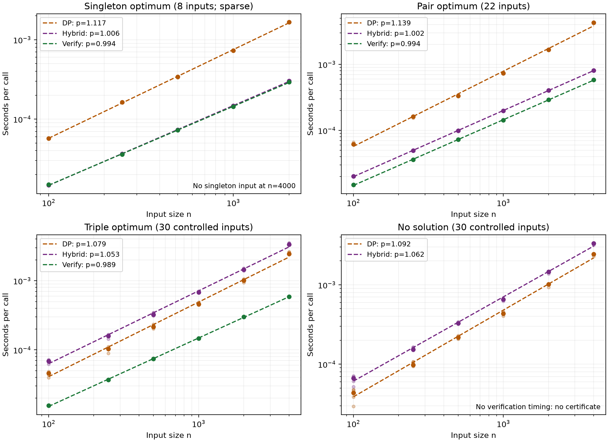

# All subset sizes: separate C rerun

Run: `20261025T153145.375462Z` (UTC). **90 inputs, 1200 timing records.**
Elapsed through validation, CSV writing, and plotting: **50.72 seconds**.

All subset sizes are allowed, including empty and full subsets. Inputs remain sorted, distinct, and strictly positive. Target zero has optimum zero; negative targets have no solution. Every timed input uses **T=n−1**; unrestricted-target performance is not tested.

The hybrid checks zero, then a singleton, then a pair, then DP. Only after excluding smaller answers does a singleton or pair establish optimality. The early paths validate once; DP fallback validates again. The verifier checks feasibility, not general optimality.

The original 30 C inputs are replayed from saved seeds: 8 now have singleton optima and 22 have pair optima. Thirty triple inputs contain {1,3,T−4}, exclude T, and contain only odd values: the odd target cannot be reached by a pair. Thirty impossible inputs contain only even values against an odd target. New master seeds are 20261026 and 20261027. These constructed cases exercise fallback; they are not evidence about hard instances. In particular, a separate parity check could reject the impossible group in linear time.

Environment: Python 3.11.16; NumPy 2.4.6; Matplotlib 3.11.2; macOS-26.6-arm64-arm-64bit.

Each method receives a warm-up, then calibration by doubling batch size to at least 20 ms (cap 65,536 calls). Five measured batches retain that call count, with method order rotated between repeats. Timings include public API validation, result construction, and loop overhead. Input construction, correctness checks, calibration, and output writing are outside timed batches. Verification checks the DP certificate and rebuilds membership sets on each call. No verifier call is timed for an impossible input.

Calibration limitations: none; no cap reached.

Times are median repeats per input, then median inputs per size. Ratios divide unrounded size medians. A ratio above 1 means the numerator took longer. Exponents fit log(time) against log(n), with equal weight per observed size. They describe this run, not proofs of asymptotic complexity. Missing sizes are shown as — and never interpolated.

## Singleton

Input counts vary by size; these are subsets of the original sample. Fits are exploratory, especially the sparse singleton group.

| Method | Fitted p | Observed sizes |
| --- | ---: | ---: |
| DP | 1.117 | 5 |
| Hybrid | 1.006 | 5 |
| Verify | 0.994 | 5 |

Times in milliseconds per call:

| n | Inputs | DP | Hybrid | Verify | DP / hybrid | DP / verify | Hybrid / verify |
| ---: | ---: | ---: | ---: | ---: | ---: | ---: | ---: |
| 100 | 1 | 0.057220 | 0.014720 | 0.014930 | 3.887 | 3.833 | 0.986 |
| 250 | 1 | 0.163589 | 0.036567 | 0.035851 | 4.474 | 4.563 | 1.020 |
| 500 | 3 | 0.340240 | 0.073458 | 0.072478 | 4.632 | 4.694 | 1.014 |
| 1000 | 2 | 0.729112 | 0.146535 | 0.143174 | 4.976 | 5.092 | 1.023 |
| 2000 | 1 | 1.666706 | 0.301019 | 0.292999 | 5.537 | 5.688 | 1.027 |
| 4000 | 0 | — | — | — | — | — | — |

## Pair

Input counts vary by size; these are subsets of the original sample. Fits are exploratory, especially the sparse singleton group.

| Method | Fitted p | Observed sizes |
| --- | ---: | ---: |
| DP | 1.139 | 6 |
| Hybrid | 1.002 | 6 |
| Verify | 0.994 | 6 |

Times in milliseconds per call:

| n | Inputs | DP | Hybrid | Verify | DP / hybrid | DP / verify | Hybrid / verify |
| ---: | ---: | ---: | ---: | ---: | ---: | ---: | ---: |
| 100 | 4 | 0.061831 | 0.020146 | 0.014993 | 3.069 | 4.124 | 1.344 |
| 250 | 4 | 0.161668 | 0.049743 | 0.036044 | 3.250 | 4.485 | 1.380 |
| 500 | 2 | 0.333020 | 0.099511 | 0.072475 | 3.347 | 4.595 | 1.373 |
| 1000 | 3 | 0.731659 | 0.197630 | 0.142958 | 3.702 | 5.118 | 1.382 |
| 2000 | 4 | 1.662763 | 0.402782 | 0.290986 | 4.128 | 5.714 | 1.384 |
| 4000 | 5 | 4.268313 | 0.809367 | 0.580758 | 5.274 | 7.350 | 1.394 |

## Triple

| Method | Fitted p | Observed sizes |
| --- | ---: | ---: |
| DP | 1.079 | 6 |
| Hybrid | 1.053 | 6 |
| Verify | 0.989 | 6 |

Times in milliseconds per call:

| n | Inputs | DP | Hybrid | Verify | DP / hybrid | DP / verify | Hybrid / verify |
| ---: | ---: | ---: | ---: | ---: | ---: | ---: | ---: |
| 100 | 5 | 0.046172 | 0.069168 | 0.015610 | 0.668 | 2.958 | 4.431 |
| 250 | 5 | 0.103396 | 0.158600 | 0.036818 | 0.652 | 2.808 | 4.308 |
| 500 | 5 | 0.216077 | 0.323042 | 0.074386 | 0.669 | 2.905 | 4.343 |
| 1000 | 5 | 0.459899 | 0.681374 | 0.146164 | 0.675 | 3.146 | 4.662 |
| 2000 | 5 | 1.009440 | 1.452521 | 0.300375 | 0.695 | 3.361 | 4.836 |
| 4000 | 5 | 2.449138 | 3.343859 | 0.588355 | 0.732 | 4.163 | 5.683 |

## No solution

| Method | Fitted p | Observed sizes |
| --- | ---: | ---: |
| DP | 1.092 | 6 |
| Hybrid | 1.062 | 6 |
| Verify | — | 0 |

Times in milliseconds per call:

| n | Inputs | DP | Hybrid | Verify | DP / hybrid | DP / verify | Hybrid / verify |
| ---: | ---: | ---: | ---: | ---: | ---: | ---: | ---: |
| 100 | 5 | 0.043587 | 0.066581 | — | 0.655 | — | — |
| 250 | 5 | 0.098149 | 0.153677 | — | 0.639 | — | — |
| 500 | 5 | 0.217574 | 0.328065 | — | 0.663 | — | — |
| 1000 | 5 | 0.432791 | 0.656267 | — | 0.659 | — | — |
| 2000 | 5 | 1.013228 | 1.457167 | — | 0.695 | — | — |
| 4000 | 5 | 2.429021 | 3.331792 | — | 0.729 | — | — |

## Interpretation

Singleton and pair paths have linear operation bounds under unit-cost arithmetic. Fallback retains O(nT) time and reconstruction storage proportional to the retained item count times T. With T=n−1 this is a quadratic upper bound; it does not require measured time to grow quadratically over these sizes. Extra checks and repeated validation can make the hybrid slower on fallback inputs. No speedup threshold is used for acceptance.



[Raw timing records](results.csv). Faint points are input medians, solid points are size medians, and dashed lines fit observed sizes only. The original experiment and its documents are unchanged; its timings are not mixed into these ratios.

## Reproduce

From the repository root:

```sh
.venv/bin/python -m pytest -q experiments/subset_sum
.venv/bin/python experiments/subset_sum/benchmark_all_sizes.py
```

Each run creates a new UTC-stamped directory and never overwrites a previous run. With restricted cache access, prefix the benchmark command with `MPLCONFIGDIR=/tmp/epistemia-mpl-cache XDG_CACHE_HOME=/tmp/epistemia-cache`. Main README, paper, site, and publication updates remain deferred.
