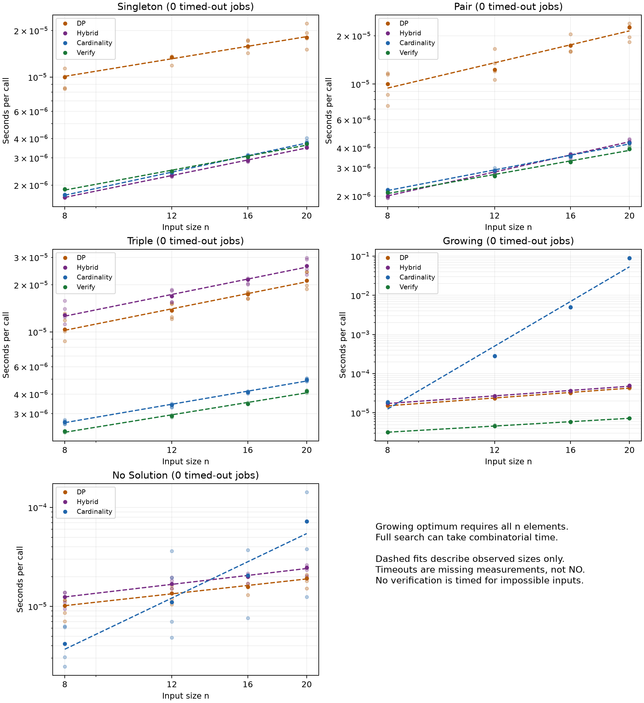

# Increasing-cardinality search: separate study

Run `20261025T154730.002061Z` (UTC): **100 inputs, 1900 timing rows, 380 method/input jobs**.
Statuses: {'COMPLETE': 380}. Elapsed through plotting: **100.94 seconds**.

The new solver checks sizes in order. For size k it fixes every combination of k−2 indices, then searches the later suffix with two pointers. First success establishes minimum cardinality; NO requires exhausting all sizes. Empty and full subsets are allowed. No DP fallback or parity shortcut is used.

Five inputs per size n=8,12,16,20 in each group. Master seeds 20261028–20261032 correspond to singleton, pair, triple, growing, and no-solution groups. Non-growing targets are T=3n+1, with values sampled from [1,6n]. Singleton inputs contain T; pair inputs exclude T and contain {1,T−1}; triple inputs exclude T and contain only odd values including {1,3,T−4}. Impossible inputs contain only even values against the odd target. Growing inputs sample from [1,3n] and target the sum of all values, so their optimum is n. These constructions establish the expected answers independently. The impossible family could be rejected cheaply by parity; it is a controlled test, not a hardness claim.

These target families differ from the earlier T=n−1 study. Compare methods within each group; do not mix historical timings into ratios.

Python 3.11.16; NumPy 2.4.6; Matplotlib 3.11.2; macOS-26.6-arm64-arm-64bit.

Every method/input job runs in a spawned worker with a 15-second deadline covering startup, warm-up, calibration, and five repeats. Recorded call times exclude startup and IPC, and include API validation, result construction, and loop overhead. Calibration doubles batches to 20 ms (cap 65,536 calls). Method order rotates between inputs. Correctness checks are outside timed batches. Timed-out jobs contribute no partial times and never count as NO. Verification uses a DP certificate and is not measured for impossible inputs.

Calibration-cap reports: 0.

Each input time is the median of five batch averages. Size times are medians across completed inputs. Ratios use the intersection of completed inputs for the two methods and divide their size medians; parentheses give the matched count. Fits use observed size medians only. Incomplete samples are biased toward jobs that completed, and are explicitly flagged below.

## Singleton

| Method | Fitted p | Sizes | Completed / timed out / error |
| --- | ---: | ---: | --- |
| DP | 0.646 | 4 | 20 / 0 / 0 |
| Hybrid | 0.805 | 4 | 20 / 0 / 0 |
| Cardinality | 0.849 | 4 | 20 / 0 / 0 |
| Verify | 0.731 | 4 | 20 / 0 / 0 |

Times in milliseconds; C denotes the new cardinality search.

| n | Optimum | DP | Hybrid | C | Verify | DP / C (matched) | Hybrid / C (matched) | C / Verify (matched) |
| ---: | ---: | ---: | ---: | ---: | ---: | ---: | ---: | ---: |
| 8 | 1 | 0.009979 | 0.001668 | 0.001726 | 0.001881 | 5.78198 (5) | 0.966223 (5) | 0.917704 (5) |
| 12 | 1 | 0.013458 | 0.002308 | 0.002416 | 0.002458 | 5.56989 (5) | 0.954997 (5) | 0.983111 (5) |
| 16 | 1 | 0.015889 | 0.002886 | 0.003092 | 0.003043 | 5.13931 (5) | 0.933405 (5) | 1.01602 (5) |
| 20 | 1 | 0.018050 | 0.003500 | 0.003760 | 0.003693 | 4.80103 (5) | 0.931034 (5) | 1.01809 (5) |

| n | Method | Completed | Timed out | Error |
| ---: | --- | ---: | ---: | ---: |
| 8 | DP | 5 | 0 | 0 |
| 8 | Hybrid | 5 | 0 | 0 |
| 8 | Cardinality | 5 | 0 | 0 |
| 8 | Verify | 5 | 0 | 0 |
| 12 | DP | 5 | 0 | 0 |
| 12 | Hybrid | 5 | 0 | 0 |
| 12 | Cardinality | 5 | 0 | 0 |
| 12 | Verify | 5 | 0 | 0 |
| 16 | DP | 5 | 0 | 0 |
| 16 | Hybrid | 5 | 0 | 0 |
| 16 | Cardinality | 5 | 0 | 0 |
| 16 | Verify | 5 | 0 | 0 |
| 20 | DP | 5 | 0 | 0 |
| 20 | Hybrid | 5 | 0 | 0 |
| 20 | Cardinality | 5 | 0 | 0 |
| 20 | Verify | 5 | 0 | 0 |

## Pair

| Method | Fitted p | Sizes | Completed / timed out / error |
| --- | ---: | ---: | --- |
| DP | 0.897 | 4 | 20 / 0 / 0 |
| Hybrid | 0.848 | 4 | 20 / 0 / 0 |
| Cardinality | 0.731 | 4 | 20 / 0 / 0 |
| Verify | 0.677 | 4 | 20 / 0 / 0 |

Times in milliseconds; C denotes the new cardinality search.

| n | Optimum | DP | Hybrid | C | Verify | DP / C (matched) | Hybrid / C (matched) | C / Verify (matched) |
| ---: | ---: | ---: | ---: | ---: | ---: | ---: | ---: | ---: |
| 8 | 2 | 0.010008 | 0.001997 | 0.002188 | 0.002109 | 4.57428 (5) | 0.912868 (5) | 1.03746 (5) |
| 12 | 2 | 0.012287 | 0.002856 | 0.002884 | 0.002674 | 4.26038 (5) | 0.990371 (5) | 1.07847 (5) |
| 16 | 2 | 0.017405 | 0.003625 | 0.003555 | 0.003270 | 4.8963 (5) | 1.01965 (5) | 1.08705 (5) |
| 20 | 2 | 0.022631 | 0.004344 | 0.004296 | 0.003941 | 5.26756 (5) | 1.01117 (5) | 1.09006 (5) |

| n | Method | Completed | Timed out | Error |
| ---: | --- | ---: | ---: | ---: |
| 8 | DP | 5 | 0 | 0 |
| 8 | Hybrid | 5 | 0 | 0 |
| 8 | Cardinality | 5 | 0 | 0 |
| 8 | Verify | 5 | 0 | 0 |
| 12 | DP | 5 | 0 | 0 |
| 12 | Hybrid | 5 | 0 | 0 |
| 12 | Cardinality | 5 | 0 | 0 |
| 12 | Verify | 5 | 0 | 0 |
| 16 | DP | 5 | 0 | 0 |
| 16 | Hybrid | 5 | 0 | 0 |
| 16 | Cardinality | 5 | 0 | 0 |
| 16 | Verify | 5 | 0 | 0 |
| 20 | DP | 5 | 0 | 0 |
| 20 | Hybrid | 5 | 0 | 0 |
| 20 | Cardinality | 5 | 0 | 0 |
| 20 | Verify | 5 | 0 | 0 |

## Triple

| Method | Fitted p | Sizes | Completed / timed out / error |
| --- | ---: | ---: | --- |
| DP | 0.780 | 4 | 20 / 0 / 0 |
| Hybrid | 0.789 | 4 | 20 / 0 / 0 |
| Cardinality | 0.669 | 4 | 20 / 0 / 0 |
| Verify | 0.634 | 4 | 20 / 0 / 0 |

Times in milliseconds; C denotes the new cardinality search.

| n | Optimum | DP | Hybrid | C | Verify | DP / C (matched) | Hybrid / C (matched) | C / Verify (matched) |
| ---: | ---: | ---: | ---: | ---: | ---: | ---: | ---: | ---: |
| 8 | 3 | 0.010405 | 0.012827 | 0.002656 | 0.002319 | 3.91809 (5) | 4.8301 (5) | 1.1453 (5) |
| 12 | 3 | 0.013754 | 0.016944 | 0.003418 | 0.002899 | 4.02384 (5) | 4.95721 (5) | 1.17905 (5) |
| 16 | 3 | 0.017402 | 0.021604 | 0.004117 | 0.003470 | 4.22642 (5) | 5.24706 (5) | 1.18648 (5) |
| 20 | 3 | 0.021326 | 0.026465 | 0.004938 | 0.004181 | 4.3186 (5) | 5.35939 (5) | 1.18095 (5) |

| n | Method | Completed | Timed out | Error |
| ---: | --- | ---: | ---: | ---: |
| 8 | DP | 5 | 0 | 0 |
| 8 | Hybrid | 5 | 0 | 0 |
| 8 | Cardinality | 5 | 0 | 0 |
| 8 | Verify | 5 | 0 | 0 |
| 12 | DP | 5 | 0 | 0 |
| 12 | Hybrid | 5 | 0 | 0 |
| 12 | Cardinality | 5 | 0 | 0 |
| 12 | Verify | 5 | 0 | 0 |
| 16 | DP | 5 | 0 | 0 |
| 16 | Hybrid | 5 | 0 | 0 |
| 16 | Cardinality | 5 | 0 | 0 |
| 16 | Verify | 5 | 0 | 0 |
| 20 | DP | 5 | 0 | 0 |
| 20 | Hybrid | 5 | 0 | 0 |
| 20 | Cardinality | 5 | 0 | 0 |
| 20 | Verify | 5 | 0 | 0 |

## Growing

| Method | Fitted p | Sizes | Completed / timed out / error |
| --- | ---: | ---: | --- |
| DP | 1.133 | 4 | 20 / 0 / 0 |
| Hybrid | 1.108 | 4 | 20 / 0 / 0 |
| Cardinality | 9.123 | 4 | 20 / 0 / 0 |
| Verify | 0.891 | 4 | 20 / 0 / 0 |

Times in milliseconds; C denotes the new cardinality search.

| n | Optimum | DP | Hybrid | C | Verify | DP / C (matched) | Hybrid / C (matched) | C / Verify (matched) |
| ---: | ---: | ---: | ---: | ---: | ---: | ---: | ---: | ---: |
| 8 | 8 | 0.015347 | 0.017531 | 0.018738 | 0.003223 | 0.819044 (5) | 0.935595 (5) | 5.8138 (5) |
| 12 | 12 | 0.023627 | 0.026790 | 0.282859 | 0.004584 | 0.0835295 (5) | 0.0947132 (5) | 61.7 (5) |
| 16 | 16 | 0.032252 | 0.036322 | 4.962203 | 0.005884 | 0.00649955 (5) | 0.0073198 (5) | 843.322 (5) |
| 20 | 20 | 0.043903 | 0.048983 | 89.081375 | 0.007328 | 0.000492841 (5) | 0.000549864 (5) | 12156.7 (5) |

| n | Method | Completed | Timed out | Error |
| ---: | --- | ---: | ---: | ---: |
| 8 | DP | 5 | 0 | 0 |
| 8 | Hybrid | 5 | 0 | 0 |
| 8 | Cardinality | 5 | 0 | 0 |
| 8 | Verify | 5 | 0 | 0 |
| 12 | DP | 5 | 0 | 0 |
| 12 | Hybrid | 5 | 0 | 0 |
| 12 | Cardinality | 5 | 0 | 0 |
| 12 | Verify | 5 | 0 | 0 |
| 16 | DP | 5 | 0 | 0 |
| 16 | Hybrid | 5 | 0 | 0 |
| 16 | Cardinality | 5 | 0 | 0 |
| 16 | Verify | 5 | 0 | 0 |
| 20 | DP | 5 | 0 | 0 |
| 20 | Hybrid | 5 | 0 | 0 |
| 20 | Cardinality | 5 | 0 | 0 |
| 20 | Verify | 5 | 0 | 0 |

## No Solution

| Method | Fitted p | Sizes | Completed / timed out / error |
| --- | ---: | ---: | --- |
| DP | 0.679 | 4 | 20 / 0 / 0 |
| Hybrid | 0.722 | 4 | 20 / 0 / 0 |
| Cardinality | 2.938 | 4 | 20 / 0 / 0 |
| Verify | — | 0 | 0 / 0 / 0 |

Times in milliseconds; C denotes the new cardinality search.

| n | Optimum | DP | Hybrid | C | Verify | DP / C (matched) | Hybrid / C (matched) | C / Verify (matched) |
| ---: | ---: | ---: | ---: | ---: | ---: | ---: | ---: | ---: |
| 8 | NO | 0.010174 | 0.012472 | 0.004196 | — | 2.42482 (5) | 2.97254 (5) | — (0) |
| 12 | NO | 0.013531 | 0.016869 | 0.011044 | — | 1.22516 (5) | 1.52735 (5) | — (0) |
| 16 | NO | 0.015796 | 0.019896 | 0.020558 | — | 0.768339 (5) | 0.96779 (5) | — (0) |
| 20 | NO | 0.019257 | 0.024600 | 0.072104 | — | 0.267068 (5) | 0.341171 (5) | — (0) |

| n | Method | Completed | Timed out | Error |
| ---: | --- | ---: | ---: | ---: |
| 8 | DP | 5 | 0 | 0 |
| 8 | Hybrid | 5 | 0 | 0 |
| 8 | Cardinality | 5 | 0 | 0 |
| 12 | DP | 5 | 0 | 0 |
| 12 | Hybrid | 5 | 0 | 0 |
| 12 | Cardinality | 5 | 0 | 0 |
| 16 | DP | 5 | 0 | 0 |
| 16 | Hybrid | 5 | 0 | 0 |
| 16 | Cardinality | 5 | 0 | 0 |
| 20 | DP | 5 | 0 | 0 |
| 20 | Hybrid | 5 | 0 | 0 |
| 20 | Cardinality | 5 | 0 | 0 |

## Limits and reproduction

For fixed k, the straightforward search bound is O(n^(k−1)). Searching all sizes has combinatorial worst-case cost. A power-law fit over four sizes does not turn that into a polynomial guarantee; this is particularly important for the growing-optimum group. Small-target DP also has favorable table sizes here. No conclusion about P versus NP follows.



[Raw times](results.csv) · [Completion and timeout ledger](ledger.csv). Faint points are input medians; solid points are size medians; dashed lines fit completed observations.

```sh
.venv/bin/python -m pytest -q experiments/subset_sum
.venv/bin/python experiments/subset_sum/benchmark_cardinality.py
```

Each run creates a fresh UTC-stamped directory. Existing implementations, results, README, paper, site, and publication remain unchanged. With restricted cache access, prefix the benchmark command with `MPLCONFIGDIR=/tmp/epistemia-mpl-cache XDG_CACHE_HOME=/tmp/epistemia-cache`.
