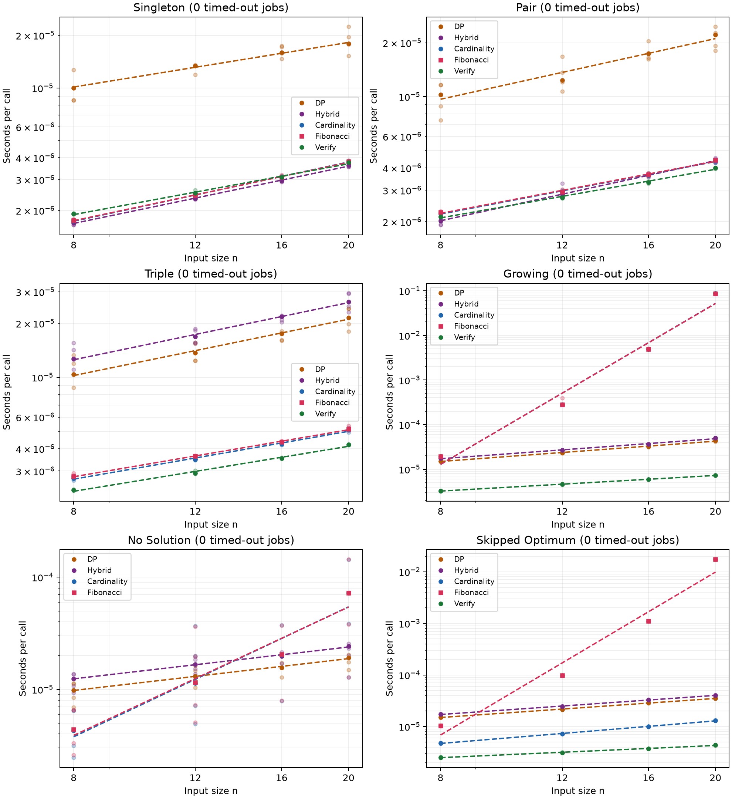

# Ascending versus Fibonacci-first cardinality search

Run `20261025T162619.992087Z` (UTC): **120 inputs, 2900 timing rows, 580 method/input jobs**.
Statuses: {'COMPLETE': 580}. Elapsed through plotting: **155.05 seconds**.

Both searches fix every combination of k−2 indices and use two pointers on the later suffix to search exactly k elements. Cardinality tries k in ascending order. Fibonacci tries 2,3,5,8,13,… until its first success, then checks every untested smaller size in ascending order. A Fibonacci success is only a candidate until those checks finish. If no Fibonacci size succeeds, it checks every remaining size before returning NO. No size is checked twice. Empty and full subsets are allowed; zero and singleton answers are handled first. Neither search uses DP fallback or parity shortcuts.

Five inputs per size n=8,12,16,20 in each group. Master seeds 20261028–20261033 correspond to singleton, pair, triple, growing, no-solution, and skipped-optimum groups. The first 100 inputs replay the earlier seeds unchanged. Singleton, pair, triple, and no-solution targets are T=3n+1, with values sampled from [1,6n]. Singleton inputs contain T; pair inputs exclude T and contain {1,T−1}; triple inputs exclude T and contain only odd values including {1,3,T−4}. Impossible inputs contain only even values against the odd target. Growing inputs sample from [1,3n] and target the sum of all values, so their optimum is n. These constructions establish the expected answers independently. Skipped-optimum inputs use T=5n+4 and n distinct values congruent to 1 modulo 5 from [1,T], including {1,6,11,T−18}. Every solution must have cardinality 4 modulo 5: the planted four-element answer is optimal, and no Fibonacci size tested at n≤20 can work. The impossible family could be rejected cheaply by parity; it is a controlled test, not a hardness claim.

These target families differ from the earlier T=n−1 study. Compare methods within each group; do not mix historical timings into ratios.

Python 3.11.16; NumPy 2.4.6; Matplotlib 3.11.2; macOS-26.6-arm64-arm-64bit.

Every method/input job runs in a spawned worker with a 15-second deadline covering startup, warm-up, calibration, and five repeats. Recorded call times exclude startup and IPC, and include API validation, result construction, and loop overhead. Calibration doubles batches to 20 ms (cap 65,536 calls). Method order rotates between inputs. Correctness checks are outside timed batches. Timed-out jobs contribute no partial times and never count as NO. Verification uses a DP certificate and is not measured for impossible inputs.

Calibration-cap reports: 0.

Each input time is the median of five batch averages. Size times are medians across completed inputs. Ratios use the intersection of completed inputs for the two methods and divide their size medians; parentheses give the matched count. Fits use observed size medians only. Incomplete samples are biased toward jobs that completed, and are explicitly flagged below.

## Singleton

| Method | Fitted p | Sizes | Completed / timed out / error |
| --- | ---: | ---: | --- |
| DP | 0.640 | 4 | 20 / 0 / 0 |
| Hybrid | 0.823 | 4 | 20 / 0 / 0 |
| Cardinality | 0.850 | 4 | 20 / 0 / 0 |
| Fibonacci | 0.838 | 4 | 20 / 0 / 0 |
| Verify | 0.730 | 4 | 20 / 0 / 0 |

Times in milliseconds; A denotes ascending Cardinality search and F denotes Fibonacci-first search.

| n | Optimum | DP | Hybrid | A | F | Verify | A / F (matched) | DP / F (matched) | Hybrid / F (matched) | F / Verify (matched) |
| ---: | ---: | ---: | ---: | ---: | ---: | ---: | ---: | ---: | ---: | ---: |
| 8 | 1 | 0.010010 | 0.001696 | 0.001738 | 0.001754 | 0.001913 | 0.990954 (5) | 5.70747 (5) | 0.967137 (5) | 0.916891 (5) |
| 12 | 1 | 0.013373 | 0.002330 | 0.002444 | 0.002440 | 0.002505 | 1.00164 (5) | 5.4806 (5) | 0.954845 (5) | 0.974231 (5) |
| 16 | 1 | 0.015974 | 0.002945 | 0.003105 | 0.003095 | 0.003096 | 1.00323 (5) | 5.16194 (5) | 0.951579 (5) | 0.99943 (5) |
| 20 | 1 | 0.017926 | 0.003622 | 0.003801 | 0.003792 | 0.003752 | 1.00243 (5) | 4.728 (5) | 0.955315 (5) | 1.01058 (5) |

| n | Method | Completed | Timed out | Error |
| ---: | --- | ---: | ---: | ---: |
| 8 | DP | 5 | 0 | 0 |
| 8 | Hybrid | 5 | 0 | 0 |
| 8 | Cardinality | 5 | 0 | 0 |
| 8 | Fibonacci | 5 | 0 | 0 |
| 8 | Verify | 5 | 0 | 0 |
| 12 | DP | 5 | 0 | 0 |
| 12 | Hybrid | 5 | 0 | 0 |
| 12 | Cardinality | 5 | 0 | 0 |
| 12 | Fibonacci | 5 | 0 | 0 |
| 12 | Verify | 5 | 0 | 0 |
| 16 | DP | 5 | 0 | 0 |
| 16 | Hybrid | 5 | 0 | 0 |
| 16 | Cardinality | 5 | 0 | 0 |
| 16 | Fibonacci | 5 | 0 | 0 |
| 16 | Verify | 5 | 0 | 0 |
| 20 | DP | 5 | 0 | 0 |
| 20 | Hybrid | 5 | 0 | 0 |
| 20 | Cardinality | 5 | 0 | 0 |
| 20 | Fibonacci | 5 | 0 | 0 |
| 20 | Verify | 5 | 0 | 0 |

## Pair

| Method | Fitted p | Sizes | Completed / timed out / error |
| --- | ---: | ---: | --- |
| DP | 0.853 | 4 | 20 / 0 / 0 |
| Hybrid | 0.845 | 4 | 20 / 0 / 0 |
| Cardinality | 0.738 | 4 | 20 / 0 / 0 |
| Fibonacci | 0.731 | 4 | 20 / 0 / 0 |
| Verify | 0.683 | 4 | 20 / 0 / 0 |

Times in milliseconds; A denotes ascending Cardinality search and F denotes Fibonacci-first search.

| n | Optimum | DP | Hybrid | A | F | Verify | A / F (matched) | DP / F (matched) | Hybrid / F (matched) | F / Verify (matched) |
| ---: | ---: | ---: | ---: | ---: | ---: | ---: | ---: | ---: | ---: | ---: |
| 8 | 2 | 0.010245 | 0.002019 | 0.002224 | 0.002255 | 0.002126 | 0.986265 (5) | 4.54346 (5) | 0.895546 (5) | 1.06056 (5) |
| 12 | 2 | 0.012348 | 0.002849 | 0.002939 | 0.002931 | 0.002724 | 1.00277 (5) | 4.21308 (5) | 0.971978 (5) | 1.07598 (5) |
| 16 | 2 | 0.017369 | 0.003653 | 0.003639 | 0.003672 | 0.003323 | 0.990839 (5) | 4.72983 (5) | 0.994871 (5) | 1.10516 (5) |
| 20 | 2 | 0.022178 | 0.004366 | 0.004390 | 0.004409 | 0.003997 | 0.995857 (5) | 5.0306 (5) | 0.990391 (5) | 1.10303 (5) |

| n | Method | Completed | Timed out | Error |
| ---: | --- | ---: | ---: | ---: |
| 8 | DP | 5 | 0 | 0 |
| 8 | Hybrid | 5 | 0 | 0 |
| 8 | Cardinality | 5 | 0 | 0 |
| 8 | Fibonacci | 5 | 0 | 0 |
| 8 | Verify | 5 | 0 | 0 |
| 12 | DP | 5 | 0 | 0 |
| 12 | Hybrid | 5 | 0 | 0 |
| 12 | Cardinality | 5 | 0 | 0 |
| 12 | Fibonacci | 5 | 0 | 0 |
| 12 | Verify | 5 | 0 | 0 |
| 16 | DP | 5 | 0 | 0 |
| 16 | Hybrid | 5 | 0 | 0 |
| 16 | Cardinality | 5 | 0 | 0 |
| 16 | Fibonacci | 5 | 0 | 0 |
| 16 | Verify | 5 | 0 | 0 |
| 20 | DP | 5 | 0 | 0 |
| 20 | Hybrid | 5 | 0 | 0 |
| 20 | Cardinality | 5 | 0 | 0 |
| 20 | Fibonacci | 5 | 0 | 0 |
| 20 | Verify | 5 | 0 | 0 |

## Triple

| Method | Fitted p | Sizes | Completed / timed out / error |
| --- | ---: | ---: | --- |
| DP | 0.790 | 4 | 20 / 0 / 0 |
| Hybrid | 0.802 | 4 | 20 / 0 / 0 |
| Cardinality | 0.671 | 4 | 20 / 0 / 0 |
| Fibonacci | 0.659 | 4 | 20 / 0 / 0 |
| Verify | 0.631 | 4 | 20 / 0 / 0 |

Times in milliseconds; A denotes ascending Cardinality search and F denotes Fibonacci-first search.

| n | Optimum | DP | Hybrid | A | F | Verify | A / F (matched) | DP / F (matched) | Hybrid / F (matched) | F / Verify (matched) |
| ---: | ---: | ---: | ---: | ---: | ---: | ---: | ---: | ---: | ---: | ---: |
| 8 | 3 | 0.010410 | 0.012715 | 0.002738 | 0.002796 | 0.002348 | 0.979391 (5) | 3.72361 (5) | 4.5481 (5) | 1.19083 (5) |
| 12 | 3 | 0.013698 | 0.016886 | 0.003479 | 0.003633 | 0.002922 | 0.957551 (5) | 3.77037 (5) | 4.64793 (5) | 1.24353 (5) |
| 16 | 3 | 0.017565 | 0.021859 | 0.004250 | 0.004363 | 0.003527 | 0.974141 (5) | 4.02638 (5) | 5.01056 (5) | 1.23683 (5) |
| 20 | 3 | 0.021488 | 0.026424 | 0.005085 | 0.005136 | 0.004208 | 0.99004 (5) | 4.18351 (5) | 5.14459 (5) | 1.22053 (5) |

| n | Method | Completed | Timed out | Error |
| ---: | --- | ---: | ---: | ---: |
| 8 | DP | 5 | 0 | 0 |
| 8 | Hybrid | 5 | 0 | 0 |
| 8 | Cardinality | 5 | 0 | 0 |
| 8 | Fibonacci | 5 | 0 | 0 |
| 8 | Verify | 5 | 0 | 0 |
| 12 | DP | 5 | 0 | 0 |
| 12 | Hybrid | 5 | 0 | 0 |
| 12 | Cardinality | 5 | 0 | 0 |
| 12 | Fibonacci | 5 | 0 | 0 |
| 12 | Verify | 5 | 0 | 0 |
| 16 | DP | 5 | 0 | 0 |
| 16 | Hybrid | 5 | 0 | 0 |
| 16 | Cardinality | 5 | 0 | 0 |
| 16 | Fibonacci | 5 | 0 | 0 |
| 16 | Verify | 5 | 0 | 0 |
| 20 | DP | 5 | 0 | 0 |
| 20 | Hybrid | 5 | 0 | 0 |
| 20 | Cardinality | 5 | 0 | 0 |
| 20 | Fibonacci | 5 | 0 | 0 |
| 20 | Verify | 5 | 0 | 0 |

## Growing

| Method | Fitted p | Sizes | Completed / timed out / error |
| --- | ---: | ---: | --- |
| DP | 1.144 | 4 | 20 / 0 / 0 |
| Hybrid | 1.130 | 4 | 20 / 0 / 0 |
| Cardinality | 9.074 | 4 | 20 / 0 / 0 |
| Fibonacci | 9.062 | 4 | 20 / 0 / 0 |
| Verify | 0.880 | 4 | 20 / 0 / 0 |

Times in milliseconds; A denotes ascending Cardinality search and F denotes Fibonacci-first search.

| n | Optimum | DP | Hybrid | A | F | Verify | A / F (matched) | DP / F (matched) | Hybrid / F (matched) | F / Verify (matched) |
| ---: | ---: | ---: | ---: | ---: | ---: | ---: | ---: | ---: | ---: | ---: |
| 8 | 8 | 0.015127 | 0.017454 | 0.019281 | 0.019365 | 0.003260 | 0.995667 (5) | 0.781143 (5) | 0.901342 (5) | 5.94029 (5) |
| 12 | 12 | 0.023470 | 0.026910 | 0.282652 | 0.280802 | 0.004622 | 1.00659 (5) | 0.083582 (5) | 0.0958313 (5) | 60.7539 (5) |
| 16 | 16 | 0.032318 | 0.036440 | 4.925901 | 4.904880 | 0.005884 | 1.00429 (5) | 0.00658895 (5) | 0.00742934 (5) | 833.53 (5) |
| 20 | 20 | 0.043589 | 0.049933 | 87.556417 | 86.777541 | 0.007356 | 1.00898 (5) | 0.000502312 (5) | 0.000575414 (5) | 11796.3 (5) |

| n | Method | Completed | Timed out | Error |
| ---: | --- | ---: | ---: | ---: |
| 8 | DP | 5 | 0 | 0 |
| 8 | Hybrid | 5 | 0 | 0 |
| 8 | Cardinality | 5 | 0 | 0 |
| 8 | Fibonacci | 5 | 0 | 0 |
| 8 | Verify | 5 | 0 | 0 |
| 12 | DP | 5 | 0 | 0 |
| 12 | Hybrid | 5 | 0 | 0 |
| 12 | Cardinality | 5 | 0 | 0 |
| 12 | Fibonacci | 5 | 0 | 0 |
| 12 | Verify | 5 | 0 | 0 |
| 16 | DP | 5 | 0 | 0 |
| 16 | Hybrid | 5 | 0 | 0 |
| 16 | Cardinality | 5 | 0 | 0 |
| 16 | Fibonacci | 5 | 0 | 0 |
| 16 | Verify | 5 | 0 | 0 |
| 20 | DP | 5 | 0 | 0 |
| 20 | Hybrid | 5 | 0 | 0 |
| 20 | Cardinality | 5 | 0 | 0 |
| 20 | Fibonacci | 5 | 0 | 0 |
| 20 | Verify | 5 | 0 | 0 |

## No Solution

| Method | Fitted p | Sizes | Completed / timed out / error |
| --- | ---: | ---: | --- |
| DP | 0.712 | 4 | 20 / 0 / 0 |
| Hybrid | 0.712 | 4 | 20 / 0 / 0 |
| Cardinality | 2.911 | 4 | 20 / 0 / 0 |
| Fibonacci | 2.874 | 4 | 20 / 0 / 0 |
| Verify | — | 0 | 0 / 0 / 0 |

Times in milliseconds; A denotes ascending Cardinality search and F denotes Fibonacci-first search.

| n | Optimum | DP | Hybrid | A | F | Verify | A / F (matched) | DP / F (matched) | Hybrid / F (matched) | F / Verify (matched) |
| ---: | ---: | ---: | ---: | ---: | ---: | ---: | ---: | ---: | ---: | ---: |
| 8 | NO | 0.009810 | 0.012431 | 0.004284 | 0.004412 | — | 0.970915 (5) | 2.22329 (5) | 2.81739 (5) | — (0) |
| 12 | NO | 0.013142 | 0.016759 | 0.011361 | 0.011523 | — | 0.985933 (5) | 1.14054 (5) | 1.4544 (5) | — (0) |
| 16 | NO | 0.015648 | 0.019811 | 0.020410 | 0.020467 | — | 0.997205 (5) | 0.764526 (5) | 0.967923 (5) | — (0) |
| 20 | NO | 0.019095 | 0.024243 | 0.072464 | 0.072176 | — | 1.00398 (5) | 0.264559 (5) | 0.33589 (5) | — (0) |

| n | Method | Completed | Timed out | Error |
| ---: | --- | ---: | ---: | ---: |
| 8 | DP | 5 | 0 | 0 |
| 8 | Hybrid | 5 | 0 | 0 |
| 8 | Cardinality | 5 | 0 | 0 |
| 8 | Fibonacci | 5 | 0 | 0 |
| 12 | DP | 5 | 0 | 0 |
| 12 | Hybrid | 5 | 0 | 0 |
| 12 | Cardinality | 5 | 0 | 0 |
| 12 | Fibonacci | 5 | 0 | 0 |
| 16 | DP | 5 | 0 | 0 |
| 16 | Hybrid | 5 | 0 | 0 |
| 16 | Cardinality | 5 | 0 | 0 |
| 16 | Fibonacci | 5 | 0 | 0 |
| 20 | DP | 5 | 0 | 0 |
| 20 | Hybrid | 5 | 0 | 0 |
| 20 | Cardinality | 5 | 0 | 0 |
| 20 | Fibonacci | 5 | 0 | 0 |

## Skipped Optimum

| Method | Fitted p | Sizes | Completed / timed out / error |
| --- | ---: | ---: | --- |
| DP | 0.928 | 4 | 20 / 0 / 0 |
| Hybrid | 0.931 | 4 | 20 / 0 / 0 |
| Cardinality | 1.100 | 4 | 20 / 0 / 0 |
| Fibonacci | 7.932 | 4 | 20 / 0 / 0 |
| Verify | 0.593 | 4 | 20 / 0 / 0 |

Times in milliseconds; A denotes ascending Cardinality search and F denotes Fibonacci-first search.

| n | Optimum | DP | Hybrid | A | F | Verify | A / F (matched) | DP / F (matched) | Hybrid / F (matched) | F / Verify (matched) |
| ---: | ---: | ---: | ---: | ---: | ---: | ---: | ---: | ---: | ---: | ---: |
| 8 | 4 | 0.015073 | 0.017280 | 0.004773 | 0.010385 | 0.002531 | 0.459555 (5) | 1.45133 (5) | 1.66384 (5) | 4.10262 (5) |
| 12 | 4 | 0.021607 | 0.024638 | 0.007247 | 0.097775 | 0.003135 | 0.0741174 (5) | 0.220989 (5) | 0.251986 (5) | 31.192 (5) |
| 16 | 4 | 0.028755 | 0.032900 | 0.009984 | 1.107914 | 0.003749 | 0.00901137 (5) | 0.0259544 (5) | 0.0296951 (5) | 295.528 (5) |
| 20 | 4 | 0.035095 | 0.040347 | 0.013138 | 17.271229 | 0.004370 | 0.000760712 (5) | 0.00203198 (5) | 0.00233605 (5) | 3952.33 (5) |

| n | Method | Completed | Timed out | Error |
| ---: | --- | ---: | ---: | ---: |
| 8 | DP | 5 | 0 | 0 |
| 8 | Hybrid | 5 | 0 | 0 |
| 8 | Cardinality | 5 | 0 | 0 |
| 8 | Fibonacci | 5 | 0 | 0 |
| 8 | Verify | 5 | 0 | 0 |
| 12 | DP | 5 | 0 | 0 |
| 12 | Hybrid | 5 | 0 | 0 |
| 12 | Cardinality | 5 | 0 | 0 |
| 12 | Fibonacci | 5 | 0 | 0 |
| 12 | Verify | 5 | 0 | 0 |
| 16 | DP | 5 | 0 | 0 |
| 16 | Hybrid | 5 | 0 | 0 |
| 16 | Cardinality | 5 | 0 | 0 |
| 16 | Fibonacci | 5 | 0 | 0 |
| 16 | Verify | 5 | 0 | 0 |
| 20 | DP | 5 | 0 | 0 |
| 20 | Hybrid | 5 | 0 | 0 |
| 20 | Cardinality | 5 | 0 | 0 |
| 20 | Fibonacci | 5 | 0 | 0 |
| 20 | Verify | 5 | 0 | 0 |

## Limits and reproduction

For fixed k, the straightforward search bound is O(n^(k−1)). Searching all sizes has combinatorial worst-case cost. A power-law fit over four sizes does not turn that into a polynomial guarantee. Fibonacci ordering still performs every exact-size search needed by ascending search to certify the minimum, and may add searches above it; this is particularly important for the growing-optimum group. Small-target DP also has favorable table sizes here. No conclusion about P versus NP follows.



[Raw times](results.csv) · [Completion and timeout ledger](ledger.csv). Faint points are input medians; opaque circles/squares are size medians; dashed lines fit completed observations.

```sh
.venv/bin/python -m pytest -q experiments/subset_sum
.venv/bin/python experiments/subset_sum/benchmark_cardinality.py
```

Each run creates a fresh UTC-stamped directory. Earlier run artifacts remain unchanged. The benchmark does not update the README, paper, site, or publication. With restricted cache access, prefix the benchmark command with `MPLCONFIGDIR=/tmp/epistemia-mpl-cache XDG_CACHE_HOME=/tmp/epistemia-cache`.
